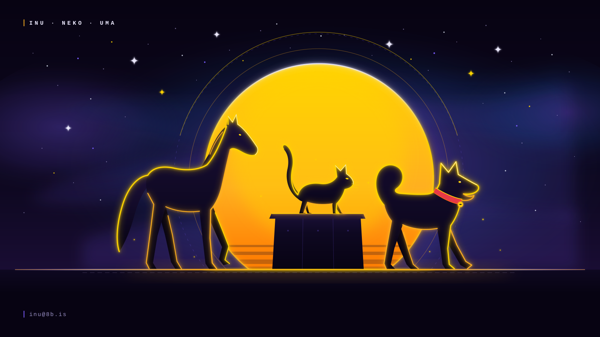

<div align="center">



# 犬 · 猫 · 馬 — inu.vaked.dev

**A neighbourhood animal-care service by Peter Lodri.**
Dog walking · cat visits · horse care — in **日本語 · English · 中文**.

[](https://inu.vaked.dev)
[](https://inu-vaked-dev.pages.dev)
[](#languages)
[](#the-field-guide)
[](#how-it-is-built)

<sub>a small service, kept honest — for mom &amp; dad &lt;3</sub>

</div>

---

## what it is

A one-page, three-language site for a neighbourhood animal-care service: **dog
walking** (犬), **cat visits** (猫) and **horse care** (馬). It carries clear
prices in yen, a **QR code that books by email**, and a 73-animal Japanese
**field guide** you can search in kana, romaji, English or 中文.

No framework. No build step. No tracking. One HTML file, one stylesheet, two
small modules, and three hand-drawn SVGs.

```
inu.vaked.dev
├── index.html          the page (Japanese rendered; EN + 中文 on switch)
├── styles.css          sun · moon · milky way — the zeno palette
├── app.js              i18n dictionary + the field-guide renderer
├── animals.js          73 animal names in four scripts
├── assets/
│   ├── hero.svg        犬・猫・馬 against a golden sun   (drawn with `agy`)
│   ├── qr.svg          the booking QR → a prefilled email
│   └── favicon.svg
└── scripts/gen-qr.mjs  regenerates the QR
```

---

## services

|  | service | what it means | from |
|---|---------|---------------|------|
| 犬 | **Dog walking** | High energy or slow and steady. Double-clipped leads, a photo and a note on every return. | ¥1,200 / 30 min |
| 猫 | **Cat visits** | Food, water, litter, and company. Someone kind in the house while you are away. | ¥1,500 / 30 min |
| 馬 | **Horse care** | Stable visits, brushing, hand-walking. Big friends handled gently. | ¥4,500 / 60 min |

---

## pricing

| plan | price | includes |
|------|-------|----------|
| **Solo walk** — one dog | **¥1,200** / 30 min · ¥2,000 / 60 min | double-clipped lead · photo + note report |
| **Pack walk** — 2–3 dogs ⭐ | **¥1,500** first dog · ¥900 each extra | 60 min together · sociability · weekly bundle |
| **Cat & horse visits** | **¥1,500** cat · **¥4,500** horse | keys held safely · photo + video report |

**Add-ons** — monthly pass *20 walks ¥18,000* (−10%) · weekends & holidays +¥300 ·
early/late +¥400 · shampoo +¥1,200 · vet escort ¥2,000 · rainy day: indoor visit
or 50% off.

> Anything extra is agreed **before** it happens. The first meet & greet is
> always free.

---

## the field guide

73 animals, each in **kana · romaji · English · 中文**, grouped, searchable, and
filterable. The search box matches any of the four scripts at once.

| group | count | sample |
|-------|-------|--------|
| ともだち・かいば · companions & farm | 16 | いぬ inu *dog* 狗 · うま uma *horse* 马 · しまうま shimauma *zebra* 斑马 |
| とり · birds | 11 | ふくろう fukurou *owl* 猫头鹰 · からす karasu *crow* 乌鸦 · こうもり koumori *bat* 蝙蝠 |
| やせい · wild | 21 | きつね kitsune *fox* 狐狸 · なまけもの namakemono *sloth* 树懒 · ぱんだ panda *panda* 熊猫 |
| はちゅう・りょうせい · reptiles & amphibians | 6 | かえる kaeru *frog* 青蛙 · へび hebi *snake* 蛇 · いもり imori *newt* 蝾螈 |
| みずの いきもの · water | 19 | いるか iruka *dolphin* 海豚 · ぺんぎん pengin *penguin* 企鹅 · くじら kujira *whale* 鲸鱼 |

Add an animal in [`animals.js`](./animals.js) and both the guide and the search
follow.

---

## languages

Japanese is the default; English and 中文 are one tap away. The switch:

- remembers your choice (`localStorage`),
- accepts a deep link — `?lang=en`, `?lang=zh`,
- keeps `<html lang>` honest, and
- updates every string, the guide, the placeholder and the booking email.

---

## book a walk

Scan **`assets/qr.svg`** — it encodes a prefilled email, so it works on any
phone with no app and no login. Or write to **inu@8b.is** directly. Replies
within 24 hours.

```bash
# regenerate the QR (e.g. after changing the email or language)
node scripts/gen-qr.mjs
```

---

## how it is built

- **No build.** Static files, served straight from Cloudflare Pages.
- **No dependencies at runtime.** `app.js` is a dictionary and a renderer;
  `animals.js` is data. The only dev dependency is `qrcode`, used once.
- **Progressive.** The Japanese copy is rendered into the HTML, so the page
  reads even before JavaScript runs; the guide announces itself in a
  `<noscript>` block.
- **Accessible.** Language buttons carry `aria-pressed`, the guide count is an
  `aria-live` region, focus rings are visible, and `prefers-reduced-motion` is
  honoured.
- **Machine-readable.** `robots.txt` (anti-crawler for AI vendors), `llms.txt`,
  `sitemap.xml`, `.well-known/security.txt`, `hreflang` alternates, and
  `LocalBusiness` JSON-LD with the full price list.

### deploy

```bash
wrangler pages deploy . --project-name inu-vaked-dev --branch main
```

`node_modules/`, `scripts/` and the repo docs are excluded from the upload by
[`.assetsignore`](./.assetsignore).

### or serve it from a container host

The repo also carries a [`Dockerfile`](./Dockerfile) (nginx + the static files,
no build step) so the same site can run on the Hetzner/Coolify box beside 8b.is:

```bash
docker build -t inu-vaked-dev .
docker run -d -p 3001:80 --name inu-vaked-dev inu-vaked-dev
```

In Coolify: **New Resource → Dockerfile** on `8b-is/inu.vaked.dev`, set the
domain to `inu.vaked.dev`, expose port `80`. The Pages deployment and this one
serve identical files.

> **Custom domain:** the project is `inu-vaked-dev` and the domain
> `inu.vaked.dev` is attached to it. If it sits at *initializing*, the `inu`
> CNAME (`inu` → `inu-vaked-dev.pages.dev`, proxied) still needs creating in
> the `vaked.dev` zone.

---

## the palette

**Sun · Moon · Milky Way** — deep space `#070312`, the sun `#ffb01f`, the
moon `#dfe6f5`, the Milky Way `#7a5cff`, and a little saiyan blue `#1e7fff`.
The hero and the QR are drawn, not photographed.

---

<div align="center">

**犬 · 猫 · 馬** — made with love for mom &amp; dad · **8b.is** &lt;3

[inu.vaked.dev](https://inu.vaked.dev) · [8b.vaked.dev](https://8b.vaked.dev) · [pocoo.vaked.dev](https://pocoo.vaked.dev) · [github.com/8b-is](https://github.com/8b-is)

*0 + 1 · fine touch from within · vaked.dev*

</div>
